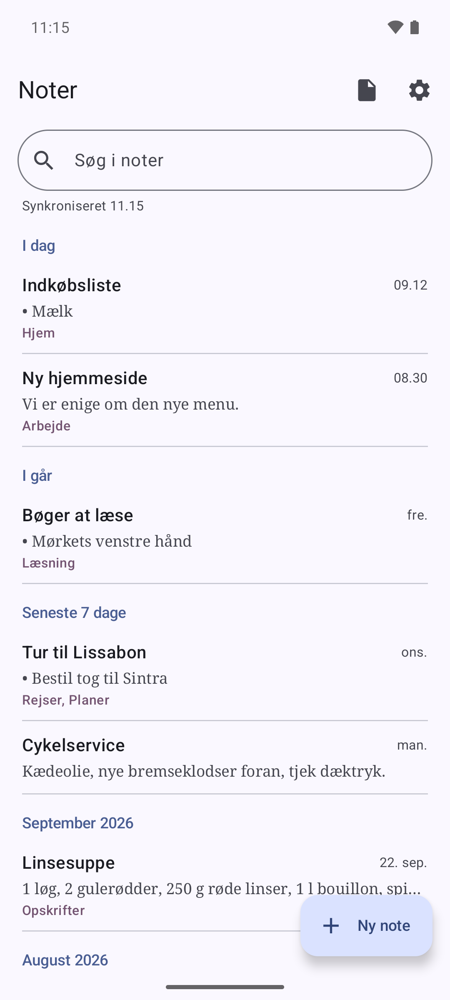
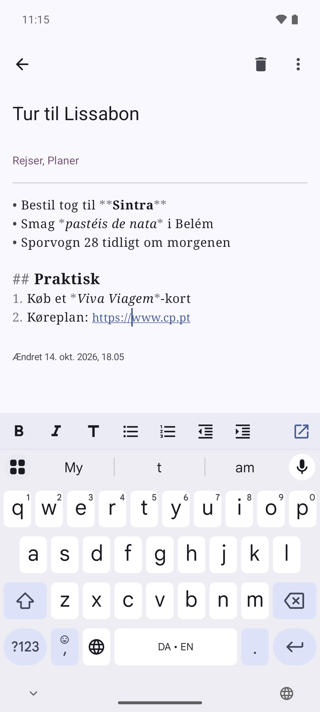
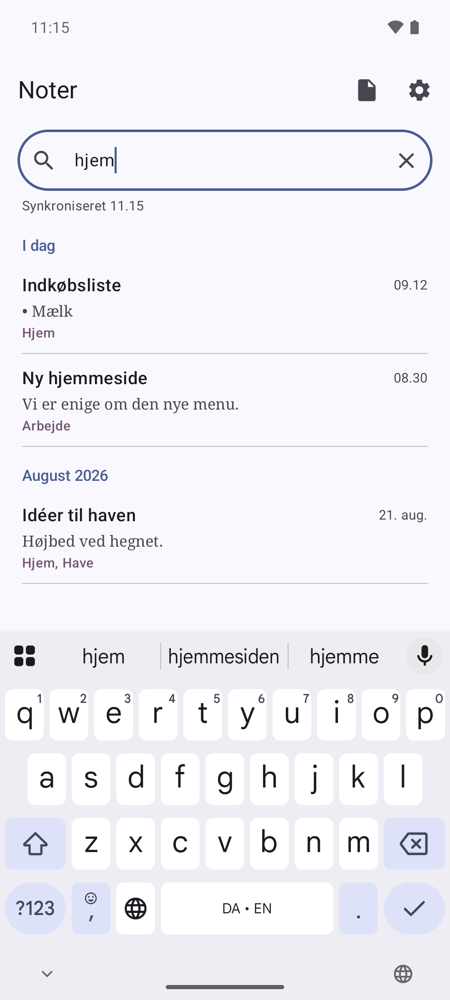

# DavNotes

[English](README.md) | **Dansk**

**Noter, der følger med dig, uden Google.**

DavNotes er en gratis og enkel noteapp til Android. Noterne ligger på en server, du selv vælger, så de er de
samme på telefonen, tabletten og i browseren. Ingen reklamer, ingen sporing og intet firma, der læser med.

<a href="https://play.google.com/store/apps/details?id=dk.rpix.noter">Hent på Google Play</a> ·
<a href="https://f-droid.org/da/packages/dk.rpix.noter/">Hent på F-Droid</a> ·
<a href="https://rpix.dk/projekter/davnotes/">Læs mere om DavNotes</a>

## Det kan appen

- **Skriv, søg og sæt tags på dine noter.** Hver note har en titel, tekst og tags, du kan søge efter.
- **Gemmer, mens du skriver.** Der er ingen gem-knap at glemme.
- **Virker uden net.** Skriv i toget eller i sommerhuset. Ændringerne sendes, så snart du er på nettet igen.
- **Mister aldrig din tekst.** Er den samme note ændret to steder på én gang, gemmes din version som en ny note
  med "(konflikt)" i titlen, så du selv kan vælge, hvad du vil beholde.
- **Let formatering.** Overskrifter, fed, kursiv, lister, afkrydsningslister, citater og links, med knapper over tastaturet.
  Noterne forbliver almindelig tekst, så andre apps stadig kan læse dem.
- **Åbn og del filer.** Gør en tekst- eller Markdown-fil til en note, eller del en note som fil til mail, Drive eller en anden app.
- **På dit sprog.** Dansk, engelsk, tysk, fransk og spansk.

## Hvor ligger mine noter?

På en kalenderserver (CalDAV). Det ved de færreste, men den slags server, der rummer din kalender, kan også rumme
noter. Du har to muligheder:

1. **En gratis konto på caldav.rpix.dk.** Det eneste, du skal bruge, er en e-mailadresse. Med den samme konto får du
   også kalendere, opgavelister og kontakter, så du kan flytte det hele væk fra Google.
   [Læs om caldav.rpix.dk](https://rpix.dk/projekter/caldav/) eller
   [opret en konto](https://caldav.rpix.dk/register.php).
2. **Din egen server.** DavNotes virker med enhver CalDAV-server, der kan synkronisere ændringer, fx
   [Radicale](https://radicale.org/).

På computeren kan du læse og skrive de samme noter i browseren med
[WebNotes](https://caldav.rpix.dk/notes/).

## Kom i gang

1. Installér DavNotes fra [Google Play](https://play.google.com/store/apps/details?id=dk.rpix.noter) eller
   [F-Droid](https://f-droid.org/da/packages/dk.rpix.noter/). Den kræver Android 7.0 eller nyere.
2. Åbn indstillingerne, og skriv serverens adresse, dit brugernavn og din adgangskode.
   Med en konto på caldav.rpix.dk er adressen `https://caldav.rpix.dk/dav/`, og brugernavnet er din e-mailadresse.
3. Tryk på **Find samlinger**, og vælg dine noter. Har du ingen noter-samling endnu, så tryk på **Opret noter-samling**.
4. Tryk på **Gem**. Så er du færdig. Noterne synkroniseres nu af sig selv.

## Godt at vide

- Adgangskoden gemmes krypteret på telefonen og sendes kun over en sikker forbindelse (HTTPS).
- Noterne virker også med andre apps, fx [jtx Board](https://jtx.techbee.at/) via [DAVx⁵](https://www.davx5.com/).
  DavNotes lader det være, som de apps har tilføjet til en note.
- Konfliktkopier er almindelige noter. Slet den, du ikke skal bruge.
- Et tag kan ikke indeholde komma, fordi komma adskiller tags.
- Thunderbird viser noter-samlingen som en tom kalender. Det er forventet: Thunderbird kan ikke vise noter.
- Spørgsmål eller idéer? Skriv til [thomas@rpix.dk](mailto:thomas@rpix.dk), eller opret et issue her på GitHub.

## For udviklere

DavNotes er open source. Hvordan appen bygges, testes og udgives, står i
[`docs/DEVELOPMENT.md`](docs/DEVELOPMENT.md) (på engelsk), og den fulde specifikation af dataformatet og
synkroniseringen står i [`docs/SPEC.md`](docs/SPEC.md). Webklienten ligger i
[lianergoist/webnotes](https://github.com/lianergoist/webnotes), og serveropsætningen bag caldav.rpix.dk i
[lianergoist/caldav](https://github.com/lianergoist/caldav).

## Licens

Udviklet i Claude af lianergoist. Udgivet under MIT-licensen, se [`LICENSE`](LICENSE).

Appen bruger biblioteker under Apache License 2.0 (AndroidX, OkHttp, Okio, Kotlin og kotlinx) og
Public Suffix List under MPL 2.0. Se [`THIRD_PARTY_NOTICES.md`](THIRD_PARTY_NOTICES.md) eller
Indstillinger → Om DavNotes i appen.

Tak til [Radicale](https://radicale.org/), [jtx Board](https://jtx.techbee.at/) og
[DAVx⁵](https://www.davx5.com/), som DavNotes er bygget til at arbejde sammen med.
