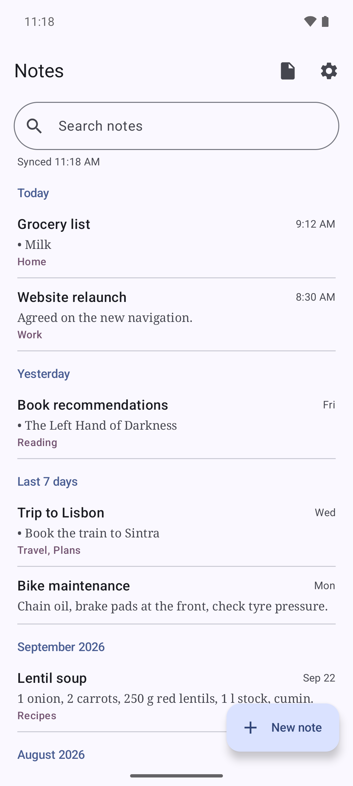
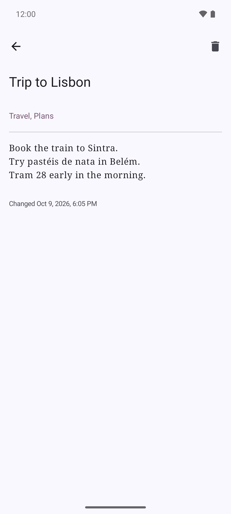
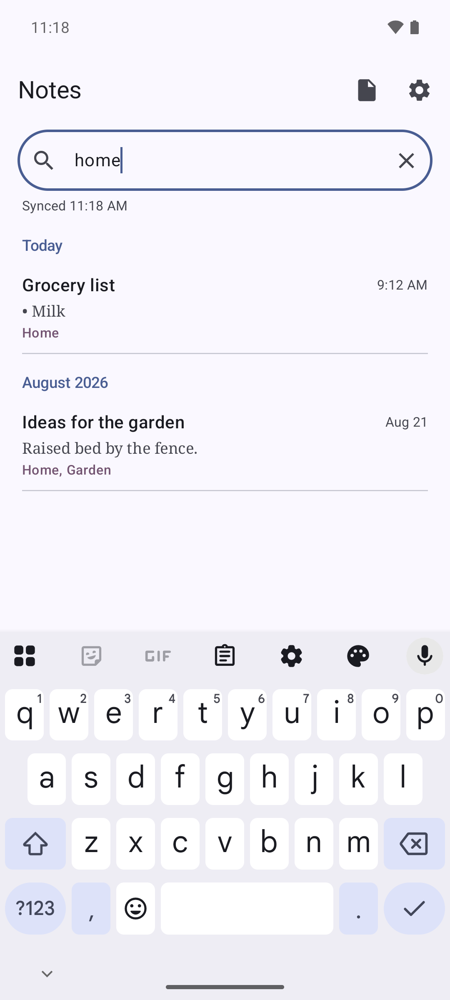

# DavNotes

**English** | [Dansk](README.da.md)

**Notes that follow you, without Google.**

DavNotes is a free and simple notes app for Android. Your notes are kept on a server you choose, so they are
the same on your phone, your tablet and in the browser. No ads, no tracking, and no company reading along.

<a href="https://play.google.com/store/apps/details?id=dk.rpix.noter">Get it on Google Play</a> ·
<a href="https://f-droid.org/en/packages/dk.rpix.noter/">Get it on F-Droid</a> ·
<a href="https://rpix.dk/projekter/davnotes/?lang=en">Read more about DavNotes</a>

## What it does

- **Write, search and tag your notes.** Each note has a title, text and tags you can search for.
- **Saves as you type.** There is no save button to forget.
- **Works without internet.** Write on the train or in the cabin. Your changes are sent as soon as you are online again.
- **Never loses your text.** If the same note was changed in two places at once, your version is kept as a new
  note with "(conflict)" in the title, so you can decide what to keep.
- **Light formatting.** Headings, bold, italic, lists, checklists, quotes and links, with buttons above the keyboard.
  Notes stay plain text, so other apps can still read them.
- **Open and share files.** Turn a text or Markdown file into a note, or share a note as a file to mail, Drive or Nextcloud.
- **In your language.** English, Danish, German, French and Spanish.

## Where are my notes kept?

On a calendar server (CalDAV). Most people don't know it, but the same kind of server that holds your calendar can
also hold notes. You have two options:

1. **A free account at caldav.rpix.dk.** All you need is an email address. The same account also gives you calendars,
   to-do lists and contacts, so you can move it all away from Google.
   [Read about caldav.rpix.dk](https://rpix.dk/projekter/caldav/?lang=en) or
   [create an account](https://caldav.rpix.dk/register.php).
2. **Your own server.** DavNotes works with any CalDAV server that supports syncing changes, for example
   [Radicale](https://radicale.org/) or Nextcloud.

On a computer you can read and write the same notes in the browser with
[WebNotes](https://caldav.rpix.dk/notes/).

## Getting started

1. Install DavNotes from [Google Play](https://play.google.com/store/apps/details?id=dk.rpix.noter) or
   [F-Droid](https://f-droid.org/en/packages/dk.rpix.noter/). It needs Android 7.0 or later.
2. Open the settings and enter the server address, your username and your password.
   With an account at caldav.rpix.dk, the address is `https://caldav.rpix.dk/dav/` and the username is your email address.
3. Tap **Find collections** and choose your notes. If you don't have a notes collection yet, tap **Create notes collection**.
4. Tap **Save**. That's it. Your notes now sync on their own.

## Good to know

- Your password is stored encrypted on the phone and is only ever sent over a secure connection (HTTPS).
- The notes also work with other apps, such as [jtx Board](https://jtx.techbee.at/) via [DAVx⁵](https://www.davx5.com/).
  DavNotes leaves alone whatever those apps have added to a note.
- Conflict copies are ordinary notes. Delete the one you don't need.
- A tag can't contain a comma, because commas separate the tags.
- Thunderbird shows the notes collection as an empty calendar. That is expected: it can't show notes.
- Questions or ideas? Write to [thomas@rpix.dk](mailto:thomas@rpix.dk) or open an issue here on GitHub.

## For developers

DavNotes is open source. How to build, test and release the app is described in
[`docs/DEVELOPMENT.md`](docs/DEVELOPMENT.md), and the full specification of the data format and the sync
rules is in [`docs/SPEC.md`](docs/SPEC.md) (in Danish). The browser client lives in
[lianergoist/webnotes](https://github.com/lianergoist/webnotes), and the server setup behind caldav.rpix.dk in
[lianergoist/caldav](https://github.com/lianergoist/caldav).

## License

Developed in Claude by lianergoist. Released under the MIT License, see [`LICENSE`](LICENSE).

The app uses libraries under the Apache License 2.0 (AndroidX, OkHttp, Okio, Kotlin and kotlinx) and
the Public Suffix List under MPL 2.0. See [`THIRD_PARTY_NOTICES.md`](THIRD_PARTY_NOTICES.md) or
Settings → About DavNotes in the app.

Thanks to [Radicale](https://radicale.org/), [jtx Board](https://jtx.techbee.at/) and
[DAVx⁵](https://www.davx5.com/), which DavNotes is built to work with.
